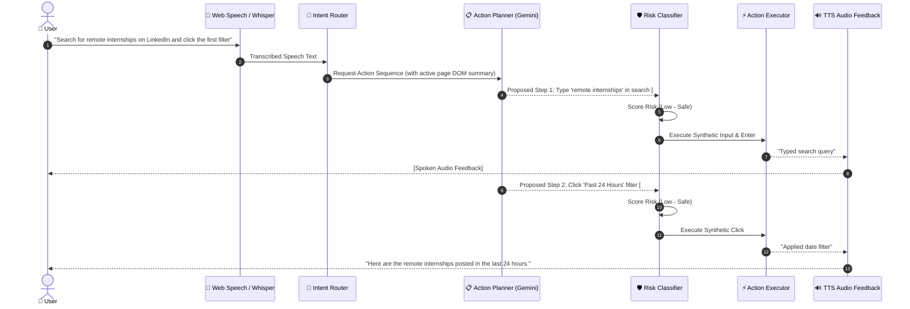
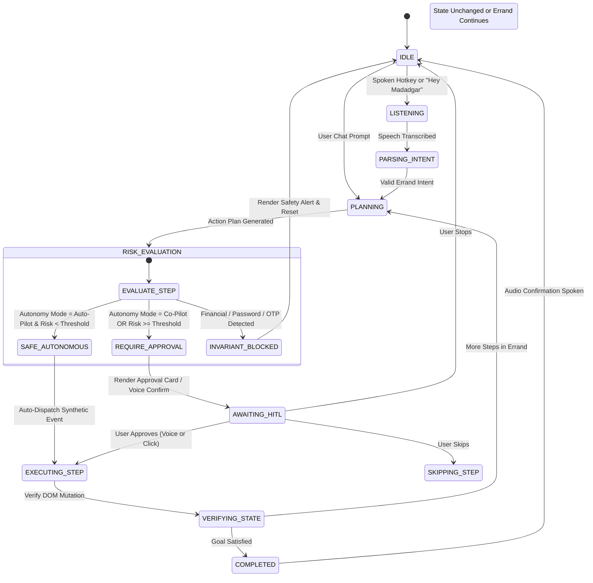
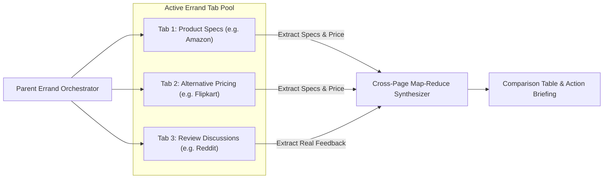
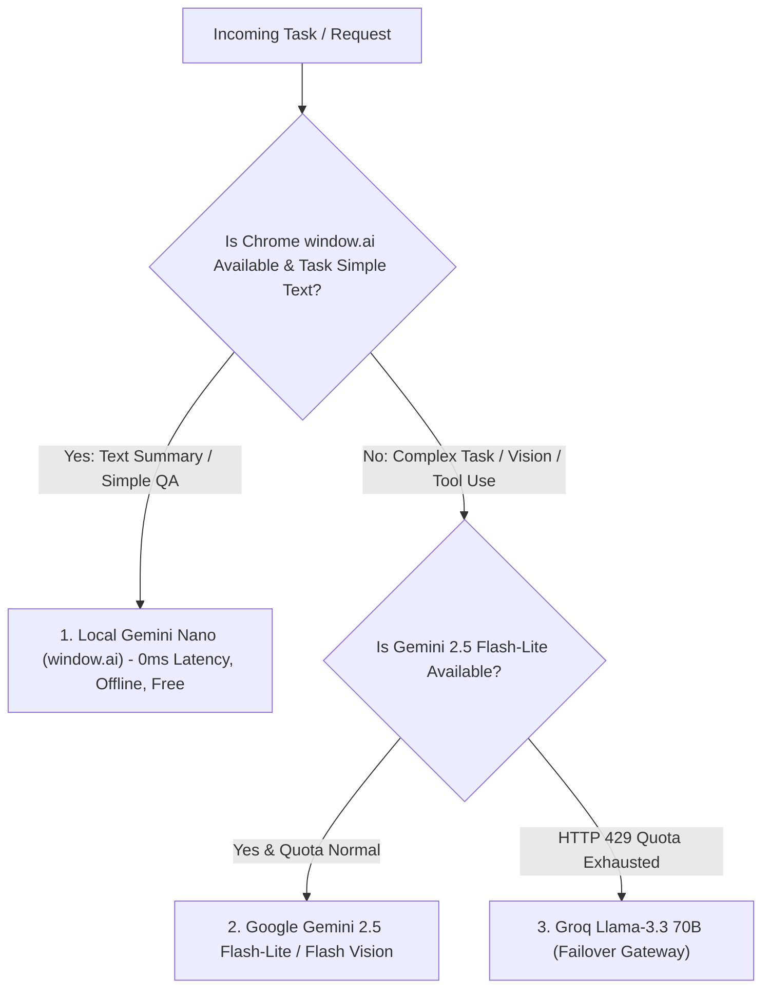

# Madadgar System Architecture: v2.0 Evolution
**Document Reference:** `v2Architecture.md`  
**Parent Roadmap:** `v2Plan.md`  
**Current Baseline:** Madadgar v1.0 (Manifest V3, Chrome Side Panel, HITL FSM)  
**Target Architecture Version:** 2.0  
**Target Environments:** Google Chrome, Microsoft Edge, Brave, Opera, Mozilla Firefox  

---

## 1. Architectural Vision & Core Paradigms

Madadgar v1.0 established the foundational **Human-in-the-Loop (HITL)** architecture: DOM scanning, badge indexers, multimodal screen inspection, profile form-filling, and step-by-step card approvals.

Madadgar v2.0 introduces four major architectural leaps:
1. **Cross-Browser Engine Portability:** Seamless operation across Chromium (Chrome, Edge, Brave, Opera) and Gecko (Mozilla Firefox) via a unified Browser API Abstraction Layer.
2. **Multi-Modal Voice Interaction Loop:** Sub-second, bidirectional voice navigation (Speech-to-Text $\rightarrow$ Intent Parser $\rightarrow$ Autonomous Action $\rightarrow$ Speech-to-Text feedback) without requiring mouse or keyboard.
3. **Configurable Tiered Autonomy:** Transition from strict step-by-step approvals to a configurable **Risk-Tiered Autonomy Engine** (Manual Co-Pilot $\leftrightarrow$ Supervised Auto-Pilot $\leftrightarrow$ Autonomous Errand Runner), guarded by deterministic code invariants.
4. **Universal Generative Composer:** Context-aware generative drafting and direct injection into modern web inputs (including `contenteditable` wrappers in Gmail, LinkedIn, X, and Notion).
5. **Hybrid Edge/Cloud Model Gateway:** On-device inference via Chrome built-in Gemini Nano (`window.ai`) and WebGPU alongside Cloud APIs (Gemini 2.5 Flash-Lite & Groq Llama 3.3).

---

## 2. Master System Topology Diagram

The following architecture topology illustrates the next-generation components across browser environments, internal subsystems, and external/local AI providers:

```mermaid
flowchart TB
    %% User Inputs
    subgraph InputLayer ["1. Multimodal User Interaction Layer"]
        UserVoice["🎤 Spoken Voice Directives (Web Speech / Whisper)"]
        UserKeyboard["⌨️ Push-to-Talk Hotkeys (Alt+V / Esc Kill Switch)"]
        UserSidePanel["🖥️ Side Panel / Sidebar UI Context"]
    end

    %% Browser Shell & Cross-Engine Abstraction
    subgraph BrowserLayer ["2. Unified Browser Abstraction Layer (CBAE)"]
        ChromiumEngine["Chromium Runtime (Chrome / Edge / Brave / Opera)"]
        GeckoEngine["Gecko Runtime (Mozilla Firefox MV3)"]
        BrowserPolyfill["webextension-polyfill Abstraction Wrapper"]
        SidebarAdapter["Sidebar & Panel Adapter (chrome.sidePanel &lt;=&gt; browser.sidebarAction)"]
    end

    %% Core Extension Subsystems
    subgraph CoreEngine ["3. Madadgar v2.0 Core Subsystems"]
        
        %% Voice Pipeline
        subgraph VoiceSubsystem ["Voice Processing Pipeline (VFIP)"]
            STTEngine["Speech-to-Text Engine (webkitSpeechRecognition + Groq Whisper)"]
            IntentParser["Voice Intent & Grammar Parser"]
            TTSEngine["Text-to-Speech Engine (Bilingual SpeechSynthesis en-IN / hi-IN)"]
        end

        %% Autonomy & Errand Engine
        subgraph AutonomySubsystem ["Tiered Autonomy Engine (TA-FSM)"]
            AutonomyController["Autonomy Slider (Co-Pilot &lt;=&gt; Auto-Pilot)"]
            RiskClassifier["Deterministic Action Risk Classifier"]
            ErrandFSM["Autonomous Action State Machine"]
            ActionRollback["Audit Trail & Synthetic Undo Stack"]
        end

        %% Multi-Tab Controller
        subgraph MultiTabSubsystem ["Multi-Tab Errand Graph (MTEG)"]
            TabCoordinator["Multi-Tab Coordinator & State Pool"]
            CrossPageExtractor["Cross-Page Map-Reduce Synthesizer"]
        end

        %% Content Composer
        subgraph ComposerSubsystem ["Universal Content Composer (UCCG)"]
            ContextHarvester["Thread & Field Context Harvester"]
            DOMInjector["Rich Text & contenteditable Injector"]
            GhostwriterWidget["Inline Floating Autocomplete Widget"]
        end

        %% Deterministic Safety
        subgraph SafetyShield ["Deterministic Safety Guardrails"]
            BankShield["Banking / UPI Domain Lockout"]
            CredentialShield["Password / CVV / OTP Shield"]
            ActionGate["Consequential Button Interceptor"]
            EmergencyKill["Hardware & Voice Kill Switch"]
        end
    end

    %% AI Providers Layer
    subgraph AIGatewayLayer ["4. Hybrid Edge / Cloud AI Gateway"]
        LocalNano["On-Device Gemini Nano (window.ai Built-in Prompt API)"]
        LocalTransformers["On-Device WebGPU / Transformers.js"]
        CloudGemini["Google Gemini 2.5 Flash-Lite & Flash (Vision)"]
        CloudGroq["Groq Llama-3.3 70B (Fast Failover & Whisper STT)"]
    end

    %% Storage Layer
    subgraph StorageLayer ["5. Local Storage & Semantic Memory"]
        LocalStorage["chrome.storage.local (Profile, Skills, API Keys)"]
        VectorDB["IndexedDB Local Vector Store (Semantic Research Memory)"]
    end

    %% Data Connections
    UserVoice --> STTEngine
    UserKeyboard --> AutonomyController
    UserKeyboard --> EmergencyKill
    UserSidePanel --> SidebarAdapter

    ChromiumEngine --> BrowserPolyfill
    GeckoEngine --> BrowserPolyfill
    BrowserPolyfill --> SidebarAdapter

    STTEngine --> IntentParser
    IntentParser --> ErrandFSM
    AutonomyController --> ErrandFSM
    RiskClassifier --> ErrandFSM
    ErrandFSM --> DOMInjector
    ErrandFSM --> TabCoordinator

    ErrandFSM --> AIGatewayLayer
    ComposerSubsystem --> AIGatewayLayer
    ErrandFSM --> SafetyShield

    SafetyShield -.->|Hard Intercept| ErrandFSM
    EmergencyKill -.->|Instant Abort| ErrandFSM

    AIGatewayLayer --> LocalNano
    AIGatewayLayer --> CloudGemini
    AIGatewayLayer --> CloudGroq

    ErrandFSM --> TTSEngine
    TTSEngine --> UserSidePanel
    TabCoordinator --> VectorDB
```



---

## 3. Subsystem Architecture Specifications

### 3.1. Subsystem A: Cross-Browser Abstraction Engine (CBAE)

#### Problem Formulation
Chrome Manifest V3 enforces `chrome.sidePanel`, while Mozilla Firefox Manifest V3 implements `sidebar_action` and enforces explicit extension IDs (`browser_specific_settings.gecko.id`).

#### Component Design
The Cross-Browser Abstraction Engine wraps browser-specific runtime calls behind a unified interface:

```typescript
// src/common/browser_adapter.ts
export interface ISidebarController {
  open(options?: { windowId?: number; tabId?: number }): Promise<void>;
  setPanel(path: string): Promise<void>;
  isOpen(): Promise<boolean>;
}

export class UniversalSidebarAdapter implements ISidebarController {
  async open(options?: { windowId?: number; tabId?: number }): Promise<void> {
    // 1. Chrome / Chromium Side Panel API
    if (typeof chrome !== 'undefined' && chrome.sidePanel && typeof chrome.sidePanel.open === 'function') {
      if (options?.windowId) {
        return chrome.sidePanel.open({ windowId: options.windowId });
      }
      return chrome.sidePanel.open({ windowId: chrome.windows.WINDOW_ID_CURRENT });
    }

    // 2. Firefox Sidebar Action API
    if (typeof browser !== 'undefined' && (browser as any).sidebarAction) {
      return (browser as any).sidebarAction.open();
    }

    // 3. Fallback Popup / Window Injection
    console.warn('[CBAE] Dedicated side panel unavailable. Spawning standalone helper window.');
  }

  async setPanel(path: string): Promise<void> {
    if (typeof chrome !== 'undefined' && chrome.sidePanel) {
      await chrome.sidePanel.setOptions({ path });
    } else if (typeof browser !== 'undefined' && (browser as any).sidebarAction) {
      await (browser as any).sidebarAction.setPanel({ panel: path });
    }
  }

  async isOpen(): Promise<boolean> {
    if (typeof browser !== 'undefined' && (browser as any).sidebarAction?.isOpen) {
      return (browser as any).sidebarAction.isOpen({});
    }
    return true;
  }
}
```

#### Dual Build Target Pipeline
* **`npm run build:chrome`**: Emits `dist/chrome` with standard Chrome MV3 `manifest.json`.
* **`npm run build:firefox`**: Emits `dist/firefox` using a specialized manifest transform that renames `side_panel` to `sidebar_action`, injects `browser_specific_settings`, and bundles background scripts.

---

### 3.2. Subsystem B: Voice-First Interaction Pipeline (VFIP)

#### Sequence Diagram: Voice-to-Action Execution


#### Voice Processing Architecture
1. **Low-Latency Speech-to-Text (STT):**
   - **Primary Engine:** Native `webkitSpeechRecognition` executing in the Side Panel context. Operates at near-zero latency with zero token consumption.
   - **Secondary Engine (Cloud Fallback):** Audio recording captured via `navigator.mediaDevices.getUserMedia` and streamed to Groq Whisper (`whisper-large-v3`) when high noise or regional dialect ambiguity is detected.
2. **Push-to-Talk & Hotkey Listeners:**
   - Global keyboard shortcuts (`Alt+V` to open voice microphone, `Escape` for instant abort).
3. **Bilingual Text-to-Speech (TTS):**
   - Natural voice selection (`en-IN`, `hi-IN`, `en-US`).
   - Supports audio summaries and hands-free spoken progress updates.

---

### 3.3. Subsystem C: Tiered Autonomy State Machine (TA-FSM)

#### Autonomy Spectrum Model

```
[ Tier 1: Co-Pilot (Strict HITL) ]
        │  • User confirms every atomic click, type, and navigation
        │  • Default mode in Madadgar v1.0
        ▼
[ Tier 2: Supervised Auto-Pilot ]
        │  • Autonomous for reading, scrolling, search, input filling
        │  • Pauses only on ambiguous UI choices or visual CAPTCHAs
        ▼
[ Tier 3: Invariant Guardrail Lockout (Hard Boundary) ]
           • Financial transactions, banking pages, password fields, OTPs
           • Absolute lock: Cannot be executed autonomously under ANY mode
```

#### State Transition Diagram


#### Deterministic Risk Classifier Matrix

| Action Type | Target Selector / Element Signature | Autonomy Score | Allowed in Auto-Pilot? |
| :--- | :--- | :---: | :---: |
| **Scroll / View** | Window, scrollable containers | `0.0` (Zero Risk) | ✅ Yes |
| **Search Input** | `input[type="search"]`, search textboxes | `0.1` (Safe) | ✅ Yes |
| **Filter Clicks** | Dropdowns, sort links, checkboxes | `0.2` (Safe) | ✅ Yes |
| **Profile Fill** | Standard name, email, degree, skills | `0.3` (Low Risk) | ✅ Yes (with visual badge) |
| **Navigation Link**| Links changing route within origin | `0.4` (Low Risk) | ✅ Yes |
| **Form Submit** | Standard search or feedback forms | `0.6` (Moderate) | ⚠️ Conditional Confirmation |
| **Irreversible Delete** | Buttons containing `Delete`, `Remove`, `Discard` | `0.9` (High Risk) | ❌ Must require approval |
| **Financial / Checkout**| Buttons containing `Pay`, `Place Order`, `Transfer` | `1.0` (Critical) | 🛑 HARD BLOCKED |
| **Credential Field**| `type="password"`, `cc-number`, `cvv`, `otp` | `1.0` (Critical) | 🛑 HARD BLOCKED |

---

### 3.4. Subsystem D: Universal Content Composer & Ghostwriter (UCCG)

#### The `contenteditable` Challenge
Modern web applications (Gmail, LinkedIn, X, Notion, Slack) do not use traditional `<textarea>` elements. Instead, they use complex DOM structures with `contenteditable="true"` and virtual cursor anchors.

#### Injection Architecture
```typescript
// src/content/universal_writer.ts
export class UniversalContentWriter {
  /**
   * Injects rich or plain text safely into standard inputs, textareas,
   * or modern contenteditable containers (Gmail, LinkedIn, Notion).
   */
  static async insertText(target: HTMLElement, text: string): Promise<boolean> {
    target.focus();

    // 1. Standard HTML Form Elements
    if (target instanceof HTMLInputElement || target instanceof HTMLTextAreaElement) {
      target.value = text;
      target.dispatchEvent(new Event('input', { bubbles: true }));
      target.dispatchEvent(new Event('change', { bubbles: true }));
      return true;
    }

    // 2. Modern contenteditable DOM Containers
    if (target.isContentEditable) {
      const selection = window.getSelection();
      if (!selection || selection.rangeCount === 0) {
        const range = document.createRange();
        range.selectNodeContents(target);
        range.collapse(false);
        selection?.removeAllRanges();
        selection?.addRange(range);
      }

      // Modern InputEvent dispatch with synthetic insertion
      const inputEvent = new InputEvent('beforeinput', {
        inputType: 'insertText',
        data: text,
        bubbles: true,
        cancelable: true,
      });

      const allowed = target.dispatchEvent(inputEvent);
      if (allowed) {
        document.execCommand('insertText', false, text);
        target.dispatchEvent(new Event('input', { bubbles: true }));
        return true;
      }
    }

    return false;
  }
}
```

#### Inline Ghostwriter Architecture
* Injects an ephemeral floating completion pill anchored to active text selections.
* Pressing `Tab` accepts completions.
* Pressing `Escape` or continuing to type dismisses suggestions.

---

### 3.5. Subsystem E: Multi-Tab Errand Graph (MTEG)

#### Multi-Tab Errand Graph Schema


#### State Serialization & Tab Tracking
```typescript
export interface IMultiTabErrandSession {
  sessionId: string;
  objective: string;
  parentTabId: number;
  spawnedTabIds: number[];
  sharedContext: Record<string, any>;
  phase: 'DISCOVERY' | 'PARALLEL_EXTRACT' | 'SYNTHESIS' | 'COMPLETE';
  completedSubtasks: Array<{ tabId: number; title: string; data: any }>;
}
```

---

### 3.6. Subsystem F: Hybrid Edge / Cloud AI Gateway (HCE-AIG)

#### Three-Tier Inference Router


1. **Tier 0 (On-Device Local AI):** Chrome's built-in **Gemini Nano** (`window.ai.languageModel`). Executes on user hardware, 100% offline, zero API keys required.
2. **Tier 1 (Cloud Primary):** **Google Gemini 2.5 Flash-Lite** (for DOM action planning, structured extraction) and **Gemini 2.5 Flash** (for vision-guided viewport queries).
3. **Tier 2 (Resilient Failover):** **Groq Llama-3.3 70B Versatile** + **Whisper-large-v3** for low-latency text failover and audio transcription.

---

## 4. Security & Safety Invariants in Autonomous Mode

As Madadgar advances into autonomous browsing, code-level deterministic safety guardrails remain the absolute priority:

```
┌────────────────────────────────────────────────────────────────────────┐
│             NON-NEGOTIABLE SAFETY INVARIANTS IN AUTONOMOUS MODE         │
├──────────────────────────┬─────────────────────────────────────────────┤
│ 1. Domain Blacklist      │ Instant shutdown on all banking, UPI, and   │
│    Lockout               │ payment gateway domains.                    │
├──────────────────────────┼─────────────────────────────────────────────┤
│ 2. Credential Sanitizer  │ Zero typing or reading in password, OTP,    │
│                          │ PIN, or credit card fields.                 │
├──────────────────────────┼─────────────────────────────────────────────┤
│ 3. Consequential Button  │ Actions on Submit, Pay, Transfer, Delete,   │
│    Interception          │ and Order buttons demand explicit user sign-│
│                          │ off regardless of the autonomy setting.     │
├──────────────────────────┼─────────────────────────────────────────────┤
│ 4. Hardware Kill Switch  │ Pressing 'Escape' or clicking the header    │
│                          │ Stop button aborts all FSM execution, active│
│                          │ audio recognition, and resets DOM overlays. │
└──────────────────────────┴─────────────────────────────────────────────┘
```

---

## 5. Technical Stack & Implementation Matrix

| Component | Target Library / Tool | Justification |
| :--- | :--- | :--- |
| **Cross-Browser Core** | `webextension-polyfill` | Standardized Mozilla abstraction over `chrome.*` and `browser.*` APIs. |
| **Voice STT** | `webkitSpeechRecognition` + `Groq Whisper` | Zero latency browser-native transcription with cloud fallback for accents. |
| **Voice TTS** | Web Speech `SpeechSynthesis` | Client-side audio generation without audio streaming latency or bandwidth cost. |
| **On-Device AI** | Chrome Built-in Prompt API (`window.ai`) | Zero API-key barrier for new users; fully private offline execution. |
| **Vector Memory** | `transformers.js` + `IndexedDB` | In-browser embeddings generation and cosine similarity for browsing history. |
| **DOM Engine** | Enhanced `action_executor.ts` | Complete support for `contenteditable` inputs, range selection, and synthetic events. |

---

## 6. Phased Implementation Milestones

```
Phase 5: Voice Foundations & Cross-Browser Engine (Weeks 1-3)
├── Deliverable 5.1: webextension-polyfill & Firefox SidebarAdapter integration
├── Deliverable 5.2: Speech-to-Text (STT) & Push-to-Talk (Alt+V) pipeline
├── Deliverable 5.3: Text-to-Speech (TTS) bilingual audio playback (En/Hinglish)
└── Deliverable 5.4: Dual build system (npm run build:chrome, npm run build:firefox)

Phase 6: Tiered Autonomy & Universal Content Composer (Weeks 4-6)
├── Deliverable 6.1: Risk Classifier & Supervised Auto-Pilot FSM
├── Deliverable 6.2: Universal contenteditable writer (Gmail, LinkedIn, Notion)
├── Deliverable 6.3: Voice-directed navigation commands (scroll, click, search)
└── Deliverable 6.4: Inline Ghostwriter autocomplete widget

Phase 7: Multi-Tab Intelligence & Edge AI (Weeks 7-9)
├── Deliverable 7.1: Multi-Tab Errand Graph & Cross-Page Synthesizer
├── Deliverable 7.2: Chrome Gemini Nano (window.ai) on-device inference fallback
└── Deliverable 7.3: Local vector memory store for semantic browsing history
```

