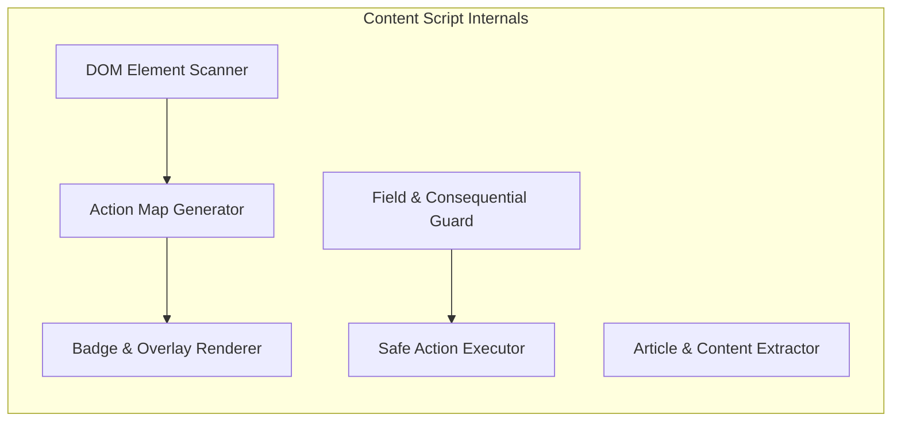
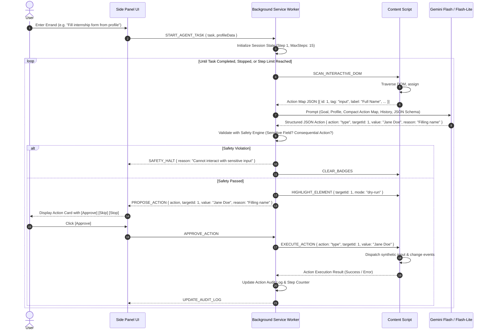
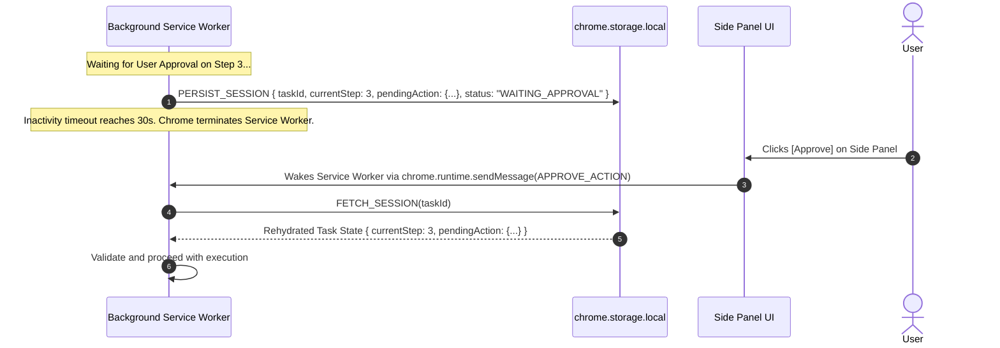
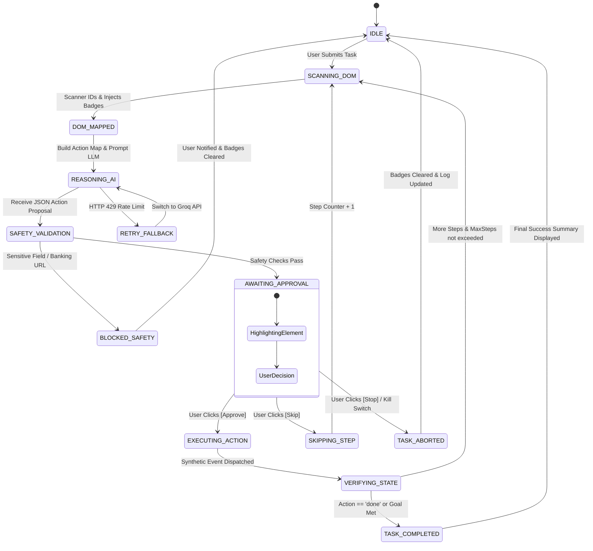

# Madadgar System Architecture Document
**Version:** 1.0  
**Target Platform:** Google Chrome Desktop (Manifest V3)  
**Project Spec Reference:** `docs/problemstatement.md`  
**Status:** Approved for Implementation  

---

## 1. Executive Summary & Design Philosophy

**Madadgar** ("The Helper") is a privacy-first, user-controlled Chrome extension operating within the Chrome Side Panel. Designed to bridge the gap between passive AI chat and active browser navigation, Madadgar understands active web pages, visually inspects visible viewports, and performs guided browser actions without ever taking autonomous control away from the user.

### Core Architectural Tenets

1. **Human-in-the-Loop (HITL) by Design**: The agent never executes browser actions autonomously. Every action follows an atomic cycle: `Sense -> Reason -> Propose -> User Approval -> Execute -> Verify`.
2. **Deterministic Code-Level Guardrails**: Safety rules (blocking banking domains, credit cards, passwords, OTP fields, consequential triggers) are strictly enforced by deterministic TypeScript/JavaScript logic in content scripts and the service worker—never delegated solely to LLM prompt adherence.
3. **Local-First & Ephemeral State**: User profile data, custom skills, and API keys reside exclusively in `chrome.storage.local`. No proprietary remote backend is required; all LLM communication occurs directly from the extension client to official model provider APIs using the user's keys.
4. **Resilience on the Free Tier**: Intelligent model fallbacks (Gemini 2.5 Flash-Lite as default, Gemini 2.5 Flash for vision/complex reasoning, Groq Llama-3 text fallback for rate-limit resilience) paired with token-minified DOM representations ensure continuous reliability within free-tier quotas.
5. **Manifest V3 Worker Lifecycle Persistence**: Full decoupling of agent state machines into persistent storage ensures active errand loops survive background service worker suspensions and wake-ups.

---

## 2. System Architecture Diagrams

### 2.1. End-to-End Multi-Tier System Diagram
The following detailed system diagram represents the complete topology of **Madadgar**, illustrating runtime boundaries, Chrome Manifest V3 execution contexts, internal component modules, data stores, and external cloud AI services:

```mermaid
flowchart TB
    %% User & External Browser Layer
    subgraph UserLayer ["1. User & Viewport Context"]
        User["👤 User (Desktop Chrome)"]
        ActivePage["🌐 Active Webpage (DOM & SPAs)"]
    end

    %% Chrome Extension Boundary
    subgraph ExtensionBoundary ["2. Chrome Extension Boundary (Manifest V3)"]
        
        %% Side Panel UI
        subgraph SidePanelBoundary ["Side Panel UI Context (React + Tailwind)"]
            SP_Root["Side Panel App Root (App.tsx)"]
            SP_Chat["Grounded Chat & Streaming View"]
            SP_Summary["Article & YouTube Summary View"]
            SP_ActionCard["HITL Approval Card [Approve | Skip | Stop]"]
            SP_Skills["Saved Skills Drawer & Runner"]
            SP_Settings["Settings & Profile Config Modal"]
            SP_Audit["Live Action Log & Timeline"]
            SP_Port["Chrome Runtime Port (Bi-directional Stream)"]
        end

        %% Isolated World: Content Scripts
        subgraph ContentScriptBoundary ["Webpage Isolated World (Content Scripts)"]
            CS_Root["Content Script Entrypoint (index.ts)"]
            CS_Scanner["DOM Element Scanner (scanner.ts)"]
            CS_Overlay["Badge & Highlight Overlay (overlay.ts)"]
            CS_Executor["Synthetic Action Executor (executor.ts)"]
            CS_Extractor["Readability & YouTube Parser (extractor.ts)"]
            CS_Guard["Field & Credential Guard (guardrails.ts)"]
        end

        %% Background Service Worker
        subgraph ServiceWorkerBoundary ["Background Service Worker (service_worker.ts)"]
            MsgBus["Type-Safe Message Bus (message_bus.ts)"]
            Orchestrator["HITL Agent State Machine (agent_orchestrator.ts)"]
            AIGateway["AI Gateway & Fallback Router (ai_gateway.ts)"]
            ScreenCap["Screen Capture Controller (screen_capture.ts)"]
            CtxMenuMgr["Context Menu Manager (context_menus.ts)"]
            StateSync["Worker State Rehydration (storage_adapter.ts)"]
        end

        %% Deterministic Safety Subsystem
        subgraph SafetyEngineBoundary ["Deterministic Safety Subsystem (src/safety/)"]
            URLFilter["Banking / UPI Domain Blacklist"]
            FieldSanitizer["Sensitive Field Shield (Password/OTP/Cards)"]
            ConsequentialGate["Consequential Button Interceptor"]
            KillSwitch["Immediate Kill Switch Handler"]
        end

        %% Local Storage
        subgraph StorageBoundary ["Local Persistence (chrome.storage.local)"]
            Store_Keys["API Credentials (Gemini, Groq)"]
            Store_Profile["User Profile Memory (Personal/Academic/Work)"]
            Store_Skills["Custom Saved Skills Catalog"]
            Store_Session["Active Task Snapshot (Hibernation State)"]
            Store_Audit["Action Audit Trail Log"]
        end
    end

    %% External Cloud Services
    subgraph CloudServices ["3. External AI & Media Providers"]
        GeminiFlashLite["Google Gemini 2.5 Flash-Lite (Default Fast QA & Summaries)"]
        GeminiFlash["Google Gemini 2.5 Flash (Vision & Complex Reasoning)"]
        GroqAPI["Groq Llama-3 API (Text Fallback on HTTP 429)"]
        YouTubeService["YouTube Captions & Transcript API"]
    end

    %% Connections - User Interactions
    User -->|Views & Interacts| ActivePage
    User -->|Controls, Chats & Approves Steps| SidePanelBoundary

    %% Content Script DOM Operations
    ActivePage <-->|Inspect Interactive Elements| CS_Scanner
    ActivePage <-->|Extract Clean Text| CS_Extractor
    CS_Overlay -->|Inject Numbered Badges & Box Outlines| ActivePage
    CS_Executor -->|Dispatch Synthetic Events click/type/scroll| ActivePage
    CS_Guard -.->|Intercept Unsafe Fields| CS_Executor

    %% Inter-Process Communication (IPC)
    CS_Root <-->|chrome.tabs.sendMessage / onMessage| MsgBus
    SP_Port <-->|chrome.runtime.connect / Port Message Stream| MsgBus

    %% Service Worker Orchestration
    MsgBus <--> Orchestrator
    Orchestrator <--> StateSync
    StateSync <--> StorageBoundary
    CtxMenuMgr -->|Trigger Quick Actions| MsgBus
    ScreenCap -->|chrome.tabs.captureVisibleTab| ActivePage

    %% Safety Engine Enforcement
    Orchestrator -->|Verify URL & Target Action| SafetyEngineBoundary
    SafetyEngineBoundary -->|Allow / Block / Extra Prompt| Orchestrator

    %% Side Panel Sub-module Wiring
    SP_Root --> SP_Chat
    SP_Root --> SP_Summary
    SP_Root --> SP_ActionCard
    SP_Root --> SP_Skills
    SP_Root --> SP_Settings
    SP_Root --> SP_Audit
    SP_Root <--> SP_Port

    %% AI Gateway Routing
    Orchestrator <--> AIGateway
    AIGateway -->|Standard Text & Fast QA| GeminiFlashLite
    AIGateway -->|Viewport Screenshot & Difficult Tasks| GeminiFlash
    AIGateway -->|On 429 Rate Limit Exhaustion| GroqAPI
    CS_Extractor -->|Fetch Public Transcripts| YouTubeService
```



### 2.2. Subsystem Communication & IPC Architecture
The architecture strictly decouples responsibilities across Chrome Manifest V3 boundaries using standard asynchronous communication channels:

| Channel / Mechanism | Source | Destination | Payload / Purpose |
| :--- | :--- | :--- | :--- |
| `chrome.tabs.sendMessage` | Background Worker | Content Script | `SCAN_DOM`, `EXECUTE_ACTION`, `HIGHLIGHT_ELEMENT`, `CLEAR_BADGES` |
| `chrome.runtime.sendMessage` | Content Script | Background Worker | `ACTION_MAP_RESULT`, `EXTRACTED_CONTENT`, `GUARDRAIL_VIOLATION` |
| `chrome.runtime.connect` (Port) | Side Panel UI | Background Worker | Persistent bi-directional streaming for LLM tokens, step updates, and approvals |
| `chrome.tabs.captureVisibleTab` | Background Worker | Chrome Tab | Captures active viewport as compressed JPEG for multimodal vision questions |
| `chrome.storage.local` | Service Worker / UI | Local Disk | Persists active task state (for worker suspension), API keys, profile, and audit logs |

---

---

## 3. Core Component Architecture

### 3.1. Background Service Worker (`src/background/`)
The Background Service Worker (`service_worker.ts`) serves as the central orchestration hub and state coordinator. Because Chrome MV3 terminates idle service workers after 30 seconds of inactivity, the background architecture is **stateless in memory** and **stateful in storage**.

* **Message Dispatcher (`message_bus.ts`)**: Routes strongly-typed messages between the Content Scripts, Side Panel UI, and Context Menus.
* **Agent State Machine (`agent_orchestrator.ts`)**:
  - Manages the lifecycle of multi-step errands (`IDLE`, `SCANNING`, `REASONING`, `WAITING_APPROVAL`, `EXECUTING`, `COMPLETED`, `ABORTED`).
  - Serializes current task state into `chrome.storage.local` prior to awaiting user interaction or LLM completion, guaranteeing survival across worker hibernation.
* **AI Provider Client & Failover Controller (`ai_gateway.ts`)**:
  - Implements the Provider Pattern wrapping Google Gemini SDK and Groq SDK.
  - Implements an exponential backoff retry handler (intercepting HTTP 429 / 503).
  - Automatically degrades to text-only fallback (Groq) if Gemini quotas expire during text operations.
* **Context Menu Manager (`context_menus.ts`)**: Registers right-click menu items for *"Explain this"*, *"Translate"*, and *"Draft a reply"*, forwarding selections to the Side Panel.
* **Visual Capture Controller (`screen_capture.ts`)**: Invokes `chrome.tabs.captureVisibleTab`, cropping to target bounding boxes or downscaling to optimize token payloads for Gemini Flash.

### 3.2. Content Scripts (`src/content/`)
Content scripts run in an isolated execution world inside the active webpage tab.



1. **DOM Scanner & Action Map Generator (`scanner.ts`)**:
   - Discovers visible, interactive DOM elements: `<a>`, `<button>`, `<input>`, `<textarea>`, `<select>`, and custom elements having `role="button"`, `role="link"`, or `tabindex="0"`.
   - Filters out non-visible elements (`offsetParent === null`, `display: none`, `visibility: hidden`, opacity 0, bounding client rect size <= 0).
   - Generates a **Compressed Semantic Action Map** representing each element with a unique numeric ID (`#1`, `#2`, ...), tag name, role, accessibility label, placeholder, text snippet, and current value.
2. **Badge & Highlighter Overlay (`overlay.ts`)**:
   - Injects a zero-interference CSS overlay layer (`#madadgar-badge-container`) attached directly to the document root (or Shadow DOM) to display compact numeric badges over interactive elements.
   - Provides visual dry-run bounding boxes (green/orange outlines) when an action is proposed.
3. **Safe Action Executor (`executor.ts`)**:
   - Receives approved actions: `click`, `type`, `select`, `scroll`, and `done`.
   - Dispatches trusted-like synthetic events (`focus`, `keydown`, `keypress`, `input`, `keyup`, `change`, `blur`, `click`) to ensure compatibility with modern reactive frameworks (React, Angular, Vue).
4. **Article & Transcript Extractor (`extractor.ts`)**:
   - Injects Mozilla `Readability.js` on article pages to eliminate navigational boilerplate, ads, and footers.
   - Extracts YouTube video IDs from the URL and fetches public transcripts via transcript track scraping or direct API.
5. **Page Guardrails (`guardrails.ts`)**:
   - Scans target inputs before action execution: inspects `type="password"`, autocomplete tags (`cc-number`, `current-password`, `one-time-code`), and detects OTP/card regex patterns. Blocks action immediately if triggered.

### 3.3. Chrome Side Panel UI (`src/sidepanel/`)
Constructed with React and styled with Tailwind CSS, providing a responsive interface docked beside the web page.

* **Tabs & Navigation**:
  - **Chat / Grounded QA**: Contextual conversation with streaming support, strict source grounding, and citations.
  - **Summarizer**: Instant article / YouTube TL;DR with 5 bullet points, next actions, and English/Hinglish toggle.
  - **Agent Pilot**: Interactive errand console displaying the current step, numbered badge reference, proposed action card with **Approve**, **Skip**, and **Stop** buttons, dry-run toggle, step counter, and live audit log.
  - **Skills Library**: Catalog of one-click prompt templates with JSON import/export capability.
  - **Profile & Settings**: Local user profile builder, API key inputs, and safety domain whitelists/blacklists.

### 3.4. Deterministic Safety Engine (`src/safety/`)
Enforces boundary controls on both background and content layers:

* **Domain Blacklist Enforcement**: Immediate freeze on any page matching financial, banking, payment gateways, or UPI domains (e.g., `*.onlinesbi.com`, `*.hdfcbank.com`, `*paytm.com`, `*razorpay.com`, `*paypal.com`).
* **Sensitive Field Shield**: Hard blocks typing actions into fields labeled with `password`, `pin`, `cvv`, `otp`, `ssn`, `aadhaar`.
* **Consequential Action Gate**: Triggers a required secondary confirmation dialog in the side panel if an element contains critical labels (`Submit`, `Pay Now`, `Delete`, `Confirm Order`, `Transfer`).
* **Kill Switch**: Persistent, high-priority emergency Stop button instantly clears active task queues and removes content script badges.

---

## 4. Detailed Sequence & Data Flows

### 4.1. Grounded Article & YouTube Summarization Flow
```mermaid
sequenceDiagram
    autonumber
    actor User
    participant SP as Side Panel UI
    participant SW as Background Service Worker
    participant CS as Content Script
    participant AI as Gemini Flash-Lite API

    User->>SP: Click "Summarize Page"
    SP->>SW: REQUEST_SUMMARY { url, language: 'en' | 'hinglish' }
    
    alt Is YouTube Public Video
        SW->>SW: Extract Video ID & Fetch Transcript
    else Standard Article Webpage
        SW->>CS: EXTRACT_READABILITY_CONTENT
        CS->>CS: Run Readability.js on DOM
        CS-->>SW: Extracted Clean Markdown / Text
    end

    SW->>AI: Generate Summary Prompt (Grounding Instructions + Content + Lang)
    AI-->>SW: Structured Response (TL;DR, 5 Points, Next Steps)
    SW-->>SP: STREAM_SUMMARY_CHUNK / COMPLETE
    SP-->>User: Render Structured Summary Card
```

### 4.2. Human-in-the-Loop (HITL) Agent Task Loop


### 4.3. Service Worker Dormancy & State Rehydration Flow
To ensure that an agent errand does not get lost when Chrome terminates the inactive Manifest V3 background service worker, all intermediate states are synced with `chrome.storage.local`:



### 4.4. HITL Agent State Machine Lifecycle
The Agent Orchestrator manages multi-step errands through a strictly deterministic Finite State Machine (FSM):



---

## 5. Data Models, Schemas & API Contracts

### 5.1. Compact Action Map Representation (Content Script -> LLM)
To reduce token costs and eliminate HTML noise, the DOM scanner converts interactive elements into a minified text schema:

```json
[
  {
    "id": 1,
    "tag": "input",
    "type": "text",
    "name": "applicant_name",
    "label": "Full Name",
    "placeholder": "Enter your legal name",
    "current_value": ""
  },
  {
    "id": 2,
    "tag": "button",
    "type": "submit",
    "label": "Next Step",
    "text": "Continue to Education"
  }
]
```

### 5.2. Strict JSON Action Schema (LLM -> Service Worker)
The model must output responses that conform to this strict JSON schema (enforced using Gemini Structured Outputs / JSON Schema validation):

```json
{
  "$schema": "http://json-schema.org/draft-07/schema#",
  "title": "AgentActionProposal",
  "type": "object",
  "properties": {
    "action": {
      "type": "string",
      "enum": ["click", "type", "select", "scroll", "done", "fail"]
    },
    "target_id": {
      "type": "integer",
      "description": "The numeric ID of the badge element from the action map"
    },
    "value": {
      "type": "string",
      "description": "The text to type or select value, if applicable"
    },
    "reason": {
      "type": "string",
      "description": "Clear, one-sentence plain English explanation for the user"
    },
    "is_consequential": {
      "type": "boolean",
      "description": "True if this action submits a form, executes a delete, or makes a payment"
    }
  },
  "required": ["action", "reason"],
  "additionalProperties": false
}
```

### 5.3. Local Profile Memory (`chrome.storage.local`)
Stored locally to power one-click form filling and tailored drafting:

```typescript
interface UserProfileMemory {
  personal: {
    fullName: string;
    email: string;
    phone: string;
    location: string;
  };
  academic: {
    institution: string;
    degree: string;
    graduationYear: string;
    major: string;
  };
  professional: {
    skills: string[];
    linkedInUrl: string;
    githubUrl: string;
    portfolioUrl: string;
  };
  preferences: {
    defaultLanguage: 'en' | 'hinglish';
    tone: 'formal' | 'casual' | 'academic';
  };
}
```

### 5.4. Saved Skills Specification (Import/Export Format)
```typescript
interface SavedSkill {
  id: string;
  title: string;
  description: string;
  category: 'summary' | 'form' | 'reply' | 'custom';
  systemPromptAddendum: string;
  userPromptTemplate: string;
  requiresProfile: boolean;
  version: "1.0.0";
}
```

---

## 6. Project Directory & Modular Structure

```
c:\Anti Gravity Project\AI-BROWSER\
├── docs/
│   ├── problemstatement.md
│   └── architecture.md
├── src/
│   ├── manifest.json              # MV3 Configuration
│   ├── background/
│   │   ├── service_worker.ts      # MV3 lifecycle & event root
│   │   ├── message_bus.ts         # Type-safe communication bus
│   │   ├── agent_orchestrator.ts  # HITL loop state machine
│   │   ├── context_menus.ts       # Right-click command handlers
│   │   └── screen_capture.ts      # Tab screenshot & downscaler
│   ├── content/
│   │   ├── index.ts               # Content script entrypoint
│   │   ├── scanner.ts             # Interactive DOM inspector
│   │   ├── overlay.ts             # Badges & bounding box highlights
│   │   ├── executor.ts            # Synthetic event dispatcher
│   │   ├── extractor.ts           # Readability.js & YouTube scraper
│   │   └── guardrails.ts          # Content-level password/OTP shield
│   ├── sidepanel/
│   │   ├── index.html             # Side panel mount DOM
│   │   ├── main.tsx               # React application entry
│   │   ├── App.tsx                # Tab router & state coordinator
│   │   ├── components/
│   │   │   ├── ChatView.tsx       # Grounded QA & streaming chat
│   │   │   ├── SummaryCard.tsx    # TL;DR, 5 points, next steps
│   │   │   ├── ActionCard.tsx     # HITL approval widget [Approve/Skip/Stop]
│   │   │   ├── AuditLog.tsx       # Timeline of actions taken
│   │   │   ├── SkillsDrawer.tsx   # Skill runner & import/export
│   │   │   └── SettingsModal.tsx  # API Keys, Profile & Whitelist
│   │   └── styles/
│   │       └── globals.css        # Tailwind styling rules
│   ├── ai/
│   │   ├── ai_gateway.ts          # Unified LLM provider switch
│   │   ├── gemini_client.ts       # Gemini 2.5 Flash-Lite & Flash client
│   │   ├── groq_client.ts         # Groq API fallback client
│   │   ├── prompts/
│   │   │   ├── summarizer.ts      # En/Hinglish summarization prompts
│   │   │   ├── grounded_qa.ts     # Strict page chat grounding prompts
│   │   │   └── agent_planner.ts   # Structured JSON action generation
│   │   └── token_optimizer.ts     # Action map compact serializer
│   ├── safety/
│   │   ├── domain_rules.ts        # Financial/sensitive URL blocklist
│   │   ├── field_sanitizer.ts     # Sensitive input identifiers
│   │   └── action_validator.ts    # Consequential threshold inspector
│   └── common/
│       ├── types.ts               # Shared TypeScript schemas
│       ├── constants.ts           # Configurable defaults & step limits
│       └── storage_adapter.ts     # chrome.storage.local async wrapper
├── assets/
│   └── icons/                     # 16px, 32px, 48px, 128px logos
├── package.json
├── tsconfig.json
├── vite.config.ts                 # CRX/Vite build system
└── tailwind.config.js
```

---

## 7. Security, Privacy & Deterministic Safety Rails

### 7.1. Defense-in-Depth Safety Matrix

| Threat / Risk Vector | Detection Layer | Enforcement Mechanism | Failure Action |
| :--- | :--- | :--- | :--- |
| **Banking / UPI Credential Capture** | Background + Content Script | Match URL against known financial TLDs, host patterns (`*sbi*`, `*hdfc*`, `*paytm*`, `*upi*`). | Agent stops immediately; badges disabled; user alerted. |
| **Password & PIN Extraction** | Content Script | Inspect `<input type="password">` or fields matching `password|pin|cvv|security_code`. | Action proposal blocked; refuses to type or read field. |
| **OTP / Card Interception** | Content Script | Regex scan on field name, autocomplete tag, and placeholder for card numbers or 4-8 digit OTPs. | Action proposal rejected. |
| **Irreversible Consequential Clicks** | LLM + Safety Engine | Inspect element text (`Submit Application`, `Delete Account`, `Pay`, `Confirm Order`). | Requires explicit two-step confirmation dialog with bold warning. |
| **API Key Leakage** | Repository / Build | Keys saved exclusively in `chrome.storage.local`. Excluded from git commits and build bundles. | Checked via `.gitignore` and build-time env assertions. |
| **Runaway Agent Loops** | Agent Orchestrator | Hard-coded maximum step cap (default: 15 steps per task) + instant Stop button. | Task automatically halts when step limit is reached. |

---

## 8. Failure Modes, Rate Limiting & Resilience Strategies

### 8.1. Free-Tier Rate Limit Resilience (HTTP 429)
* **Tiered Cascade**:
  1. Primary call: `gemini-2.5-flash-lite` (low token consumption, high RPM).
  2. If vision/image input is required: `gemini-2.5-flash`.
  3. If HTTP 429 is encountered on text tasks:
     - Check retry headers (`Retry-After`).
     - Backoff exponentially (1.5s, 3s).
     - Switch seamlessly to **Groq Fallback** (e.g. `llama-3.3-70b-versatile` or `mixtral-8x7b-32768`).
  4. If all fail: Present friendly, non-fatal notification in Side Panel explaining quota exhaustion with a countdown timer.

### 8.2. Single Page Applications (SPAs) & Dynamic DOM Changes
* Dynamic frameworks (React, Next.js, Vue) frequently unmount and remount DOM nodes.
* Badges are re-scanned and synchronized upon every step completion.
* Content scripts employ dynamic element matching using multi-attribute fingerprints (tag + id + name + role + text) rather than static XPaths to ensure action target stability.

---

## 9. Phased Execution Alignment (4-Week Build Roadmap)

This architecture maps directly to the four vertical development slices defined in the Problem Statement:

* **Week 1: The Eyes (Read the Web)**
  - Implement extension shell, Side Panel UI, and `chrome.storage.local` API key management.
  - Integrate `Readability.js` content extraction and public YouTube transcript fetching.
  - Connect Gemini Flash-Lite with English and Hinglish structured summarization.
* **Week 2: The Brain (Page QA & Visuals)**
  - Implement grounded page chat with source context injection and streaming responses.
  - Implement Chrome Context Menus (*Explain*, *Translate*, *Draft a reply*).
  - Implement `chrome.tabs.captureVisibleTab` screenshot-and-ask multimodal pipeline.
  - Implement retry handling and Groq fallback cascade.
* **Week 3: The Hands (Act with Approval)**
  - Implement DOM scanner and badge overlay injection.
  - Build token-efficient Action Map and structured JSON action generation.
  - Develop HITL approval state machine with dry-run, step limits, skip, and stop controls.
  - Implement synthetic event executor and persistent action audit logs.
* **Week 4: Memory, Safety & Packaging**
  - Implement local user profile memory and form auto-fill orchestration.
  - Build Saved Skills drawer with JSON import/export.
  - Enforce deterministic code guardrails (sensitive domains, passwords, OTPs, consequential confirmation).
  - Package GitHub release ZIP, documentation, and landing page.

